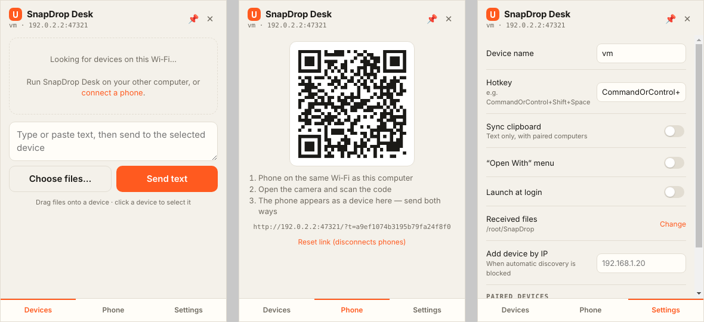
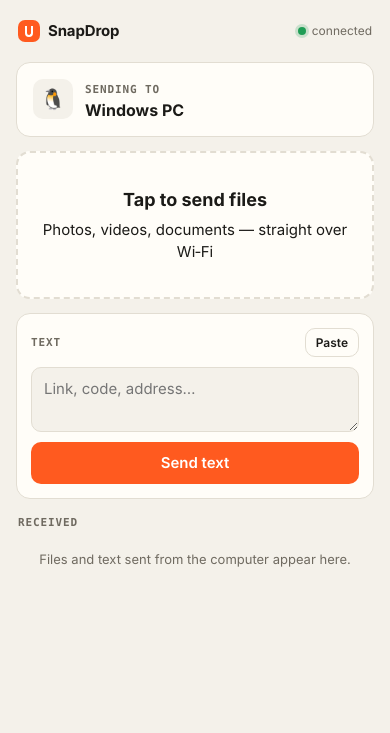

# SnapDrop Desk

**Мгновенный обмен файлами и текстом по Wi‑Fi между Mac, Windows, Linux, Android и iOS. Без облака, без аккаунтов.**

*Instant local file & text sharing across your devices over Wi‑Fi — tray app for desktops, zero-install web client for phones.*



## Что умеет

- **Живёт в трее / менюбаре.** Никаких окон, пока не нужно.
- **Горячая клавиша** `Ctrl+Shift+Space` (`⌘⇧Space` на Mac) открывает мини‑окно прямо под курсором → перетаскиваешь файл на плитку устройства → файл улетает.
- **Контекстное меню:** Windows — «Отправить → SnapDrop Desk», Linux — «Открыть с помощью», macOS — бросить файлы на иконку в менюбаре или на иконку приложения.
- **Синхронизация буфера обмена** (текст) между спаренными компьютерами на одном столе: скопировал на Mac — вставил на Windows.
- **Телефоны без установки:** сканируешь QR‑код камерой — в браузере открывается клиент. Шлёшь фото/видео/доки с телефона на ПК и обратно, текст с кнопкой «Копировать».
- **Автопоиск** устройств в сети через mDNS/Bonjour; если сеть его режет — добавление по IP.
- Файлы стримятся напрямую на диск (гигабайтные видео — не проблема), прогресс в окне и на иконке.

<p align="center"></p>

## Как это работает

```
 ┌──────────── Mac ────────────┐          ┌────────── Windows ──────────┐
 │ трей · хоткей · drop‑окно   │  mDNS    │ трей · хоткей · drop‑окно   │
 │ SnapNode HTTP :47321  ◄─────┼──────────┼─────►  SnapNode HTTP :47321 │
 │ ClipboardSync ──────────────┼─ /api/text (kind=clipboard) ──────────► │
 └──────────────▲──────────────┘          └─────────────────────────────┘
                │ QR: http://192.168.x.x:47321/?t=<token>
         ┌──────┴──────┐
         │ 📱 браузер  │  загрузка: POST /api/upload
         │ (iOS/Andr.) │  приём:    WebSocket /ws → ссылка на скачивание
         └─────────────┘
```

Каждое устройство поднимает один HTTP‑сервер (`src/core/node.js`). Между компьютерами файлы идут обычным `POST` потоком, телефоны подключаются по WebSocket и получают файлы ссылкой на скачивание. Ядро не зависит от Electron — тот же код работает в десктоп‑приложении, в консольном режиме и в тестах.

### Безопасность

- **Первый перевод от незнакомого компьютера всегда спрашивает разрешения:** «Принять / Всегда разрешать / Отклонить».
- «Всегда разрешать» спаривает устройства: получатель генерирует случайный ключ и отдаёт его отправителю. Дальше запросы без ключа отклоняются — подделать ID устройства недостаточно.
- Синхронизация буфера работает **только между спаренными** компьютерами и только если она включена.
- Телефон пускается по токену из QR‑кода (нужно физически видеть экран). Токен можно сбросить — все телефоны отключатся.
- Имена файлов очищаются (`../`, зарезервированные имена Windows), существующие файлы не перезаписываются: `photo.jpg` → `photo (1).jpg`.
- Трафик идёт только внутри локальной сети и **не шифруется TLS** — используйте в домашней/рабочей Wi‑Fi, не в публичной. См. roadmap.

## Запуск

Нужен Node.js 20+.

```bash
git clone https://github.com/montauk-dotcom/SnapDropDesk.git
cd SnapDropDesk
npm install
npm start
```

Запусти на втором компьютере в той же сети — он появится в окне сам. Для телефона: трей → «Connect phone (QR code)».

**Две копии на одной машине** (для разработки):

```bash
SNAPDROP_USER_DATA=/tmp/snap-b npm start
```

### Сборка установщиков

```bash
npm run dist:mac     # .dmg / .zip
npm run dist:win     # NSIS‑установщик + portable .exe
npm run dist:linux   # AppImage + .deb
```

GitHub Actions собирает все три платформы на каждый тег `v*` (см. `.github/workflows/ci.yml`).

### Консольный режим (без Electron)

Для Linux‑сервера, Raspberry Pi или просто проверить протокол:

```bash
node src/cli.js                              # приём, QR для телефона в терминале
node src/cli.js send video.mp4 --to "MacBook"   # по имени (mDNS)
node src/cli.js send *.pdf --to 192.168.1.20    # или по IP
node src/cli.js text "https://…" --to MacBook
```

## Файлы и порты

| Что | Где |
|---|---|
| Порт | `47321/tcp` (если занят — следующий свободный). Разрешите в брандмауэре при первом запуске. |
| mDNS | `_snapdrop._tcp` |
| Принятые файлы | `~/Downloads/SnapDrop` (меняется в настройках) |
| Настройки и пары | `settings.json` в папке данных приложения |

## Структура

```
src/
  core/            ядро без Electron
    node.js          HTTP + WebSocket сервер, отправка/приём, доверие
    discovery.js     mDNS‑поиск
    clipboard-sync.js опрос буфера без эха
  main/            Electron: трей, хоткей, окна, интеграция с ОС
  renderer/        мини drop‑окно
  cli.js           консольный режим
web/               клиент для телефона (чистый JS, без сборки)
test/              node:test — реальные передачи между двумя узлами
```

## Тесты

```bash
npm test
```

Поднимают два узла на localhost и проверяют: отказ, разовый приём, спаривание, подделку ID, текст и буфер, телефонный клиент (загрузка, WebSocket, скачивание), path traversal, отсутствие эха в синхронизации буфера.

## Roadmap

- [ ] Шифрование (TLS с самоподписанным сертификатом + отпечаток при спаривании)
- [ ] Отправка папок (zip на лету)
- [ ] Синхронизация картинок в буфере, не только текста
- [ ] Нативные приложения для iOS/Android с Share Sheet
- [ ] Finder Quick Action для macOS

## Лицензия

MIT
